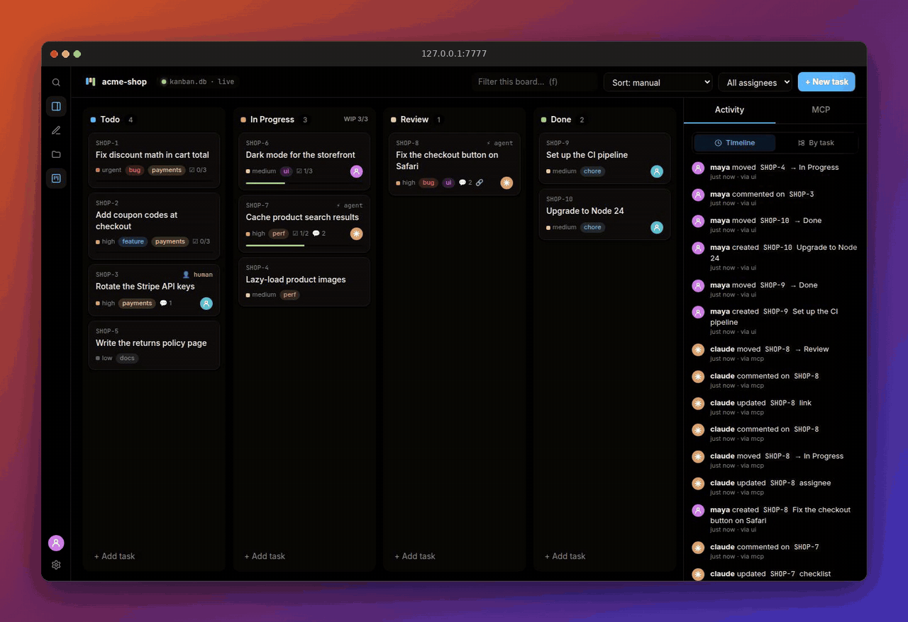
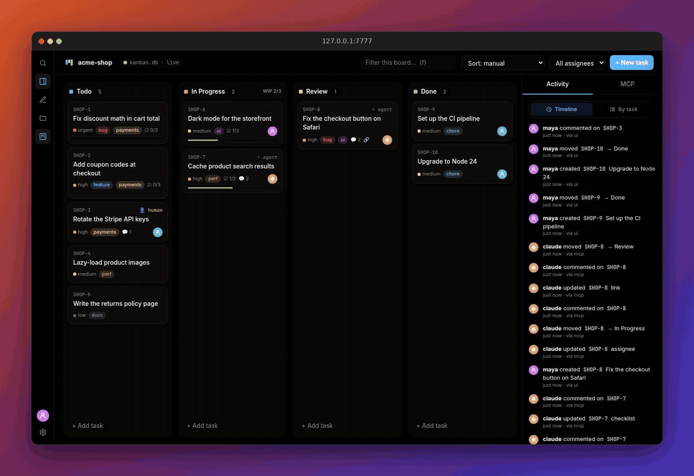
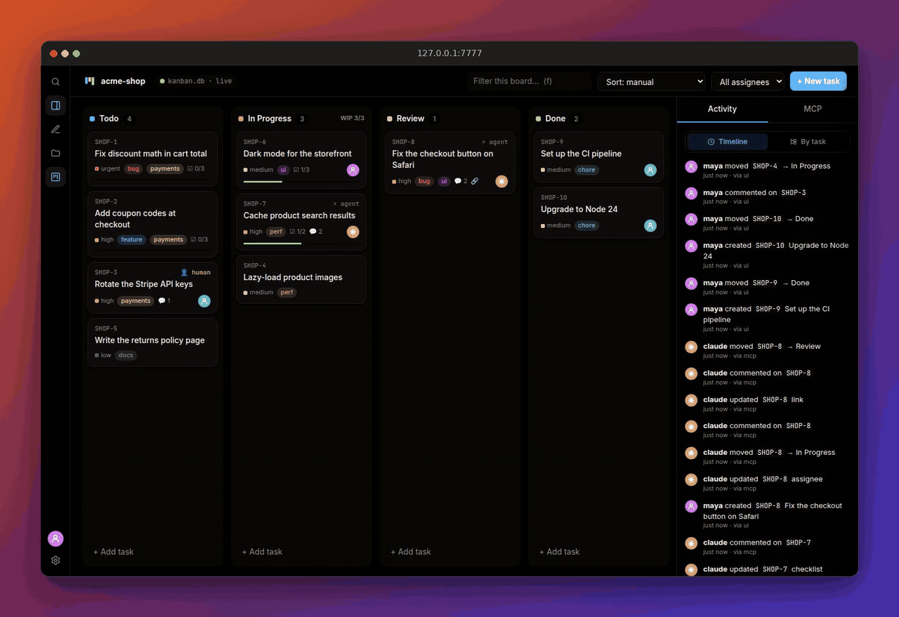
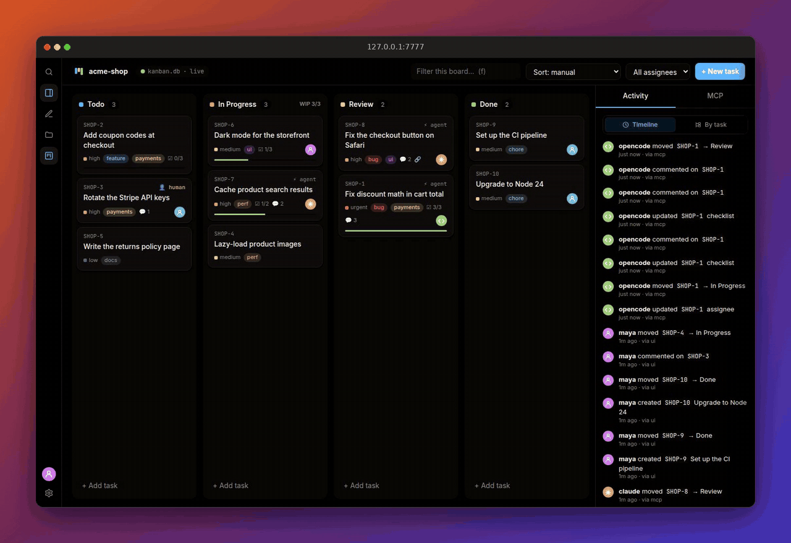
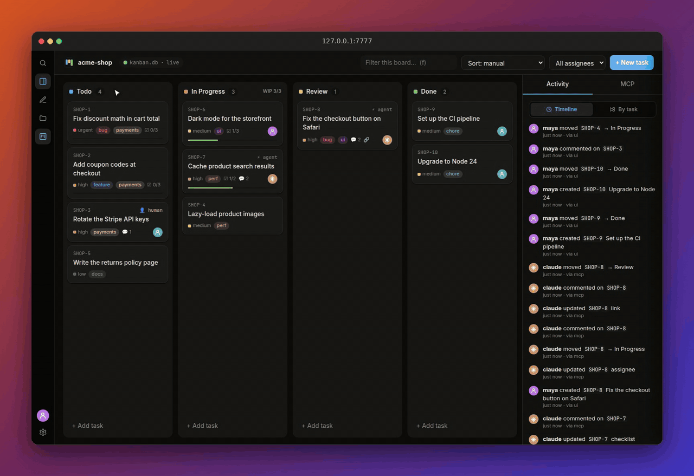

<div align="center">


# agent-kanban

**Hand your agent a ticket. Watch it ship.**

A local kanban board your coding agents work on alongside you: Claude Code, Codex, opencode, pi,
anything that speaks [MCP](https://modelcontextprotocol.io). One Go binary, one local or remote SQLite database.

[Quick start](#quick-start) · [Demos](#see-it-work) · [Download](https://github.com/Rishang/agent-kanban/releases/latest)

</div>

### 🤖 An agent takes the next task, end to end



> Left: the real **opencode** TUI. One prompt, *"Pick the next task from the kanban board and finish it"*.
> Right: the board, live. opencode calls `next_task`, writes a failing test, fixes the bug, ticks the checklist
> with `update_progress` and hands the task to **Review** with `finish_task`. Nobody touched the board.

## Quick start

Install a prebuilt binary (Linux amd64/arm64, macOS arm64, Windows amd64):

```sh
# Linux / macOS
curl -fsSL https://raw.githubusercontent.com/Rishang/agent-kanban/main/install.sh | bash
```

```powershell
# Windows (PowerShell)
irm https://raw.githubusercontent.com/Rishang/agent-kanban/main/install.ps1 | iex
```

Both scripts download the release archive, verify its SHA-256 against `checksums.txt`, and install into a user-level directory (no admin rights or sudo needed as long as that directory is writable). Set `VERSION=v1.2.3` to pin a release and `INSTALL_DIR` to choose the folder. You can also grab an archive from [Releases](https://github.com/Rishang/agent-kanban/releases/latest), or build with `task build`.

```sh
cd ~/code/my-app && agent-kanban # board at http://127.0.0.1:7777/#my-app
agent-kanban skill sync          # downloads the board-workflow skill for Claude Code / Codex into this project (--global: for all projects)
```

The skill is not built into the binary. `skill sync` fetches [`skills/kanban/SKILL.md`](skills/kanban/SKILL.md) from the `main` branch, so it needs an internet connection and picks up skill updates without a new release. Re-run it to update. Use `--url` to pin a tag or point at a mirror (HTTPS only).
The skill on `main` stays compatible with released binaries: guidance for newer tools is conditional, so agents on an older release skip what their server doesn't have.

Connect an agent (inside the repo):

```sh
claude mcp add --transport http kanban "http://127.0.0.1:7777/mcp?agent=claude&project=my-app"
```

<details><summary>Codex, opencode, others</summary>

```toml
# ~/.codex/config.toml
[mcp_servers.kanban]
url = "http://127.0.0.1:7777/mcp?agent=codex&project=my-app"
```

```json
// opencode.json
{ "mcp": { "kanban": { "type": "remote", "url": "http://127.0.0.1:7777/mcp?agent=opencode&project=my-app" } } }
```

Anything else: `http://127.0.0.1:7777/mcp?agent=<name>&project=<project>`.
</details>

## Features

| | Feature | Details |
|---|---|---|
| 🤖 | **Agent-native** | MCP endpoint for Claude Code, Codex, opencode, pi or any client; a skill teaches the workflow |
| 🛡️ | **Guardrails** | Per-project agent permissions; **human-only** tasks that agents skip |
| ⚡ | **Live** | Every change streams to open browsers over SSE; Activity shows who did what, via UI or MCP |
| 🗂️ | **Rich tasks** | Priorities, labels, assignees, due dates, checklists, comments, links, WIP limits |
| 📋 | **Plans** | Agents attach an implementation plan (MDX or an html-plan-report page) to a task; you review, edit and **Approve** it on the board before any code is written. Kept in the database, or (Settings → Plan storage) as specs in `.agent-kanban/plans/` synced both ways |
| 📝 | **Markdown** | Sanitized GitHub-flavoured markdown with highlighted code, mermaid diagrams and SVG |
| 🔎 | **Search** | Every project at once, ranked, with filters like `is:open @claude #bug prio:high` (`is:done`, `is:closed`) |
| 📁 | **Multi-project** | Each repo is a project in one shared database; task URLs like `/#my-app/KB-12` |
| 🎨 | **Themes** | Warm light and dark themes, eleven accents |
| ☁️ | **Optional sync** | Turso Cloud sync to share boards across machines; local-only by default |
| 📦 | **One binary** | Server, UI and database engine embedded; the browser loads Vue, markdown and diagram libraries from jsDelivr (pinned, SRI-checked), so the UI needs an internet connection |

## See it work

### 🗂️ A board that reads like a doc

Drag cards between columns with WIP limits. Open one for markdown, syntax-highlighted code and
**mermaid diagrams**, right in the task.



### 🔎 Find anything, across every project

`/` or `⌘K`. Ranked results with highlights, plus filters: `is:open` `@claude` `#bug` `prio:high` `project:docs`.



### 📁 Every repo is a project

Run `agent-kanban` in a repo and it joins the board, named after the git root. Switch projects in one click.



### 🎨 Make it yours, and set the rules

Light or dark, eleven accents, your own columns and labels. **Per-project permissions** decide what agents
may do, and tasks marked **human-only** are off limits to them.



## MCP tools

Agents work in a four-call loop: **`next_task` → `start_task` → `update_progress` → `finish_task`**.

| Tool | What it does |
|---|---|
| `get_board` | Columns (counts, WIP limits, roles), labels, members, priorities and your permissions. Call first. |
| `next_task` | What to work on: your in-progress task, otherwise the most urgent unassigned todo, with the reason |
| `start_task` | Assign yourself, move the task to in progress and post your plan, in one call |
| `update_progress` | Tick checklist items (by index or text), add items, post a note |
| `finish_task` | Summary + PR link, move to review (or Done with `done: true` and the *finish* permission) |
| `close_task` | Won't do (duplicate, obsolete, out of scope): posts the reason and moves the task to **Not planned**. Needs the *close* permission, off by default |
| `my_tasks` | Your open tasks, for resuming work |
| `list_tasks` | Filter by column, assignee (`me`, `none`), label or text; hides human-only tasks |
| `get_task` | Full description, checklist and comments |
| `list_labels` | Labels with task counts |
| `list_plans` | Every plan with its title and one-line description; search with `q` (BM25-ranked), `regex` or `status` |
| `set_plan` / `get_plan` | Attach a markdown/MDX implementation plan to a task, from a file in the project or inline; each change is a new numbered version (the plan keeps its own changelog), and a human approves the plan on the board before the agent builds |
| `create_task` / `create_tasks` | Create one task, or up to 50 with per-item errors; `parent` makes a sub-task |
| `update_task` / `move_task` / `check_item` / `add_comment` | Lower-level edits |
| `delete_task` | Off by default; enable in Settings → MCP & skill |

Inputs are forgiving (`"In Progress"`, `"#Bug"`, `12` or `SHOP-12`, assignee `me`), and a wrong value comes back
with the list of valid ones. Every change lands in **Activity** with who did it and how (UI or MCP).
Plans: the separate [`kanban-plan`](skills/kanban-plan/SKILL.md) skill teaches agents to write a plan, attach it with `set_plan` and wait for your **Approve** on the board.
Prompts: **`plan`** breaks a goal into tasks, **`standup`** summarizes the board.

## Configuration

Everything lives in `~/.config/kanban/` (override with `AGENT_KANBAN_CONFIG_PATH`):

| File | Holds |
|---|---|
| `kanban.db` | every project's board |
| `settings.json` | `addr` (default `127.0.0.1:7777`), `user`, `syncInterval` |
| `.env` | optional sync remote: `AGENT_KANBAN_TURSO_URL`, `AGENT_KANBAN_TURSO_TOKEN`; optional plan mirror: `AGENT_KANBAN_SUPABASE_URL`, `AGENT_KANBAN_SUPABASE_KEY` |

Precedence: flags > environment > `.env` > `settings.json`.

### Sync across machines (optional)

Local-only by default. Set a remote in `~/.config/kanban/.env` and every machine keeps its own `kanban.db`,
pushes its edits shortly after they happen and pulls everyone else's every `syncInterval` (default `30s`). One remote
holds all projects.

**Option A: Turso Cloud** (managed)

```sh
turso db create kanban && turso db show kanban --url && turso db tokens create kanban
```

```sh
# ~/.config/kanban/.env
AGENT_KANBAN_TURSO_URL=libsql://kanban-<org>.turso.io
AGENT_KANBAN_TURSO_TOKEN=eyJ...
```

**Option B: self-hosted** (`tursodb` sync server, same protocol as Turso Cloud)

```sh
# on the machine that holds the shared copy (download tursodb from github.com/tursodatabase/turso/releases)
tursodb ./kanban-remote.db --sync-server 0.0.0.0:8080
```

```sh
# ~/.config/kanban/.env on every machine
AGENT_KANBAN_TURSO_URL=http://my-server:8080
# AGENT_KANBAN_TURSO_TOKEN is optional for a self-hosted server
```

Notes:
- The self-hosted server has no auth or TLS of its own: keep it on a private network or VPN
  (e.g. Tailscale), or put it behind a reverse proxy. Turso documents it for development and testing.
- The first start with sync needs the remote, to set up the local copy. Start with a fresh `--db` when you
  turn sync on; an existing local database is not merged in.
- Conflicts resolve as last push wins. Sync is new here; keep JSON exports (Settings → Data) as backups.

### Mirror plans to Supabase

Settings → **Plan storage → Board + Supabase mirror** pushes every plan (latest version, status, approval) to a
Supabase table each time it changes, and all existing plans when you switch it on. The board stays the source of
truth; the mirror is one-way, so edits in Supabase don't come back. It is per project, and credentials are per machine.

1. Create the table in the Supabase SQL editor:
   ```sql
   create table kanban_plans (
     project text not null, task_id text not null, project_name text, title text,
     plan text, plan_format text, plan_status text,
     plan_version int, plan_approved int, updated timestamptz,
     primary key (project, task_id));
   alter table kanban_plans enable row level security; -- no policies: only the service key can read or write
   ```
2. Add to `~/.config/kanban/.env`: `AGENT_KANBAN_SUPABASE_URL=https://<ref>.supabase.co` and
   `AGENT_KANBAN_SUPABASE_KEY=<service_role or secret key>` (optionally `AGENT_KANBAN_SUPABASE_TABLE`, default `kanban_plans`).

Failures (wrong key, missing table, offline) are logged by the server and retried on the next plan change.
Plan storage is one choice per project, so it replaces the repo-files option while it is on.

## Keyboard

| Key | Does |
|---|---|
| `n` | New task |
| `/`, `⌘K` / `Ctrl+K` | Search every project (`↑` `↓` move, `↵` open) |
| `f` | Filter this board; `↵` keeps the filter, `Esc` clears it |
| `p` | Projects panel |
| `,` | Settings |
| `Tab` (in a task title) | Jump to the description |
| `⌘↵` / `Ctrl+↵` | Save and close the task |
| `Esc` | Keep what you typed in a description or tags, cancel other fields, close panels |

## Development

```sh
task dev    # server on :7788 with a throwaway config in ./tmp
task test   # also: task fmt, task lint, task build
```

The server listens on loopback only, rejects foreign `Host` headers and non-JSON posts, and sanitizes all markdown.

### Editing the skill

Every released binary syncs `skills/kanban/SKILL.md` from `main`, so a skill edit reaches users of older releases too:

- Make guidance for a new tool or permission conditional, with a fallback: "If your tools include `close_task` and `get_board` lists `+close`, …; otherwise …". Agents can see their own tool list.
- Don't remove or rename guidance for a tool that a release still ships.
- Refer to permissions and column roles as `get_board` reports them, not as a fixed list.
- Before merging, compare the tools and permissions the skill names with the oldest supported release's `tools/list` and `get_board`.
