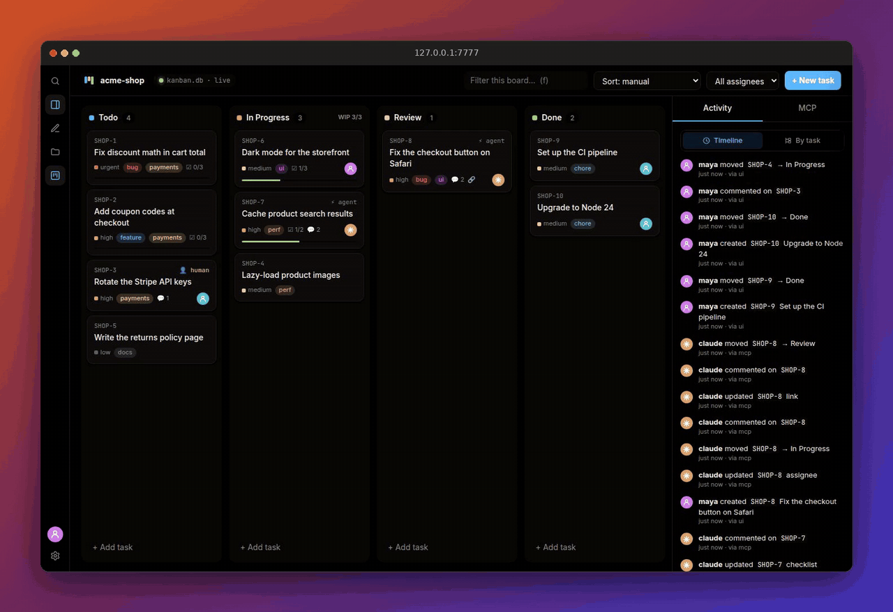
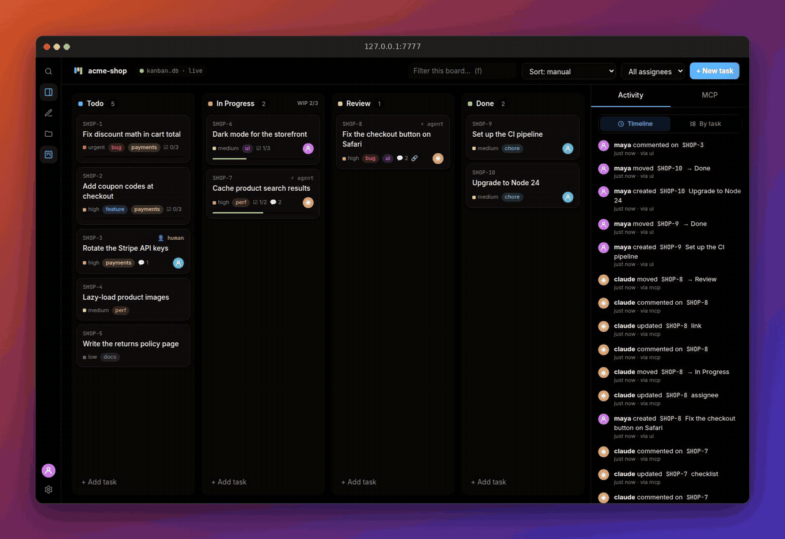
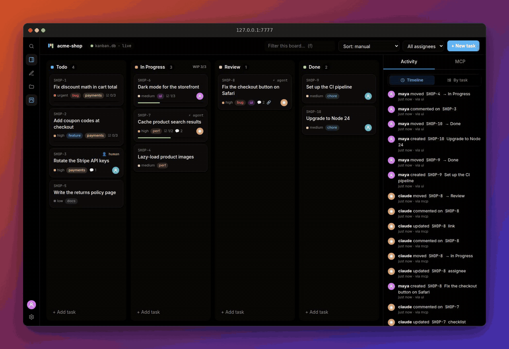
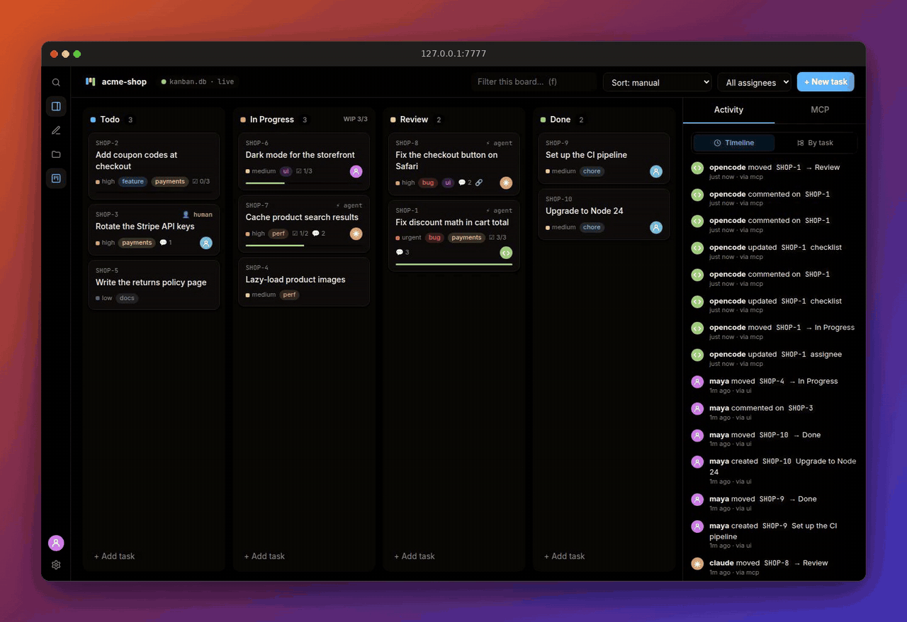
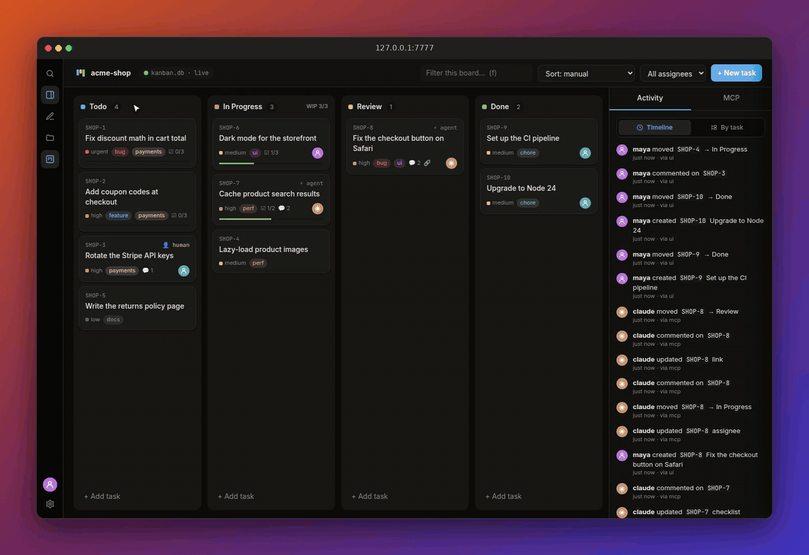

<div align="center">


# local-kanban

**Hand your agent a ticket. Watch it ship.**

A local kanban board your coding agents work on alongside you: Claude Code, Codex, opencode, pi,
anything that speaks [MCP](https://modelcontextprotocol.io). One Go binary, one local database, zero cloud.

[Quick start](#quick-start) · [Demos](#see-it-work) · [Download](https://github.com/Rishang/local-kanban/releases/latest)

</div>

### 🤖 An agent takes the next task, end to end



> Left: the real **opencode** TUI. One prompt, *"Pick the next task from the kanban board and finish it"*.
> Right: the board, live. opencode calls `next_task`, writes a failing test, fixes the bug, ticks the checklist
> with `update_progress` and hands the task to **Review** with `finish_task`. Nobody touched the board.

## Quick start

```sh
task build                       # → ./bin/local-kanban
cd ~/code/my-app && local-kanban # board at http://127.0.0.1:7777/#my-app
local-kanban skill install       # teaches Claude Code / Codex the board workflow in this project (--global: for all projects)
```

Connect an agent (inside the repo):

```sh
claude mcp add --transport http kanban "http://127.0.0.1:7777/mcp?agent=claude&project=my-app"
```

<details><summary>Codex, opencode, others</summary>

```toml
# ~/.codex/config.toml
[mcp_servers.kanban]
url = "http://127.0.0.1:7777/mcp?agent=codex&project=my-app"
```

```json
// opencode.json
{ "mcp": { "kanban": { "type": "remote", "url": "http://127.0.0.1:7777/mcp?agent=opencode&project=my-app" } } }
```

Anything else: `http://127.0.0.1:7777/mcp?agent=<name>&project=<project>`.
</details>

## Features

| | Feature | Details |
|---|---|---|
| 🤖 | **Agent-native** | MCP endpoint for Claude Code, Codex, opencode, pi or any client; a skill teaches the workflow |
| 🛡️ | **Guardrails** | Per-project agent permissions; **human-only** tasks that agents skip |
| ⚡ | **Live** | Every change streams to open browsers over SSE; Activity shows who did what, via UI or MCP |
| 🗂️ | **Rich tasks** | Priorities, labels, assignees, due dates, checklists, comments, links, WIP limits |
| 📝 | **Markdown** | Sanitized GitHub-flavoured markdown with highlighted code, mermaid diagrams and SVG |
| 🔎 | **Search** | Every project at once, ranked, with filters like `is:open @claude #bug prio:high` |
| 📁 | **Multi-project** | Each repo is a project in one shared database; task URLs like `/#my-app/KB-12` |
| 🎨 | **Themes** | Warm light and dark themes, eleven accents |
| ☁️ | **Optional sync** | Turso Cloud sync to share boards across machines; local-only by default |
| 📦 | **One binary** | UI, database engine and libraries embedded; Linux, macOS and Windows builds |

## See it work

### 🗂️ A board that reads like a doc

Drag cards between columns with WIP limits. Open one for markdown, syntax-highlighted code and
**mermaid diagrams**, right in the task.



### 🔎 Find anything, across every project

`/` or `⌘K`. Ranked results with highlights, plus filters: `is:open` `@claude` `#bug` `prio:high` `project:docs`.



### 📁 Every repo is a project

Run `local-kanban` in a repo and it joins the board, named after the git root. Switch projects in one click.



### 🎨 Make it yours, and set the rules

Light or dark, eleven accents, your own columns and labels. **Per-project permissions** decide what agents
may do, and tasks marked **human-only** are off limits to them.



## MCP tools

Agents work in a four-call loop: **`next_task` → `start_task` → `update_progress` → `finish_task`**.

| Tool | What it does |
|---|---|
| `get_board` | Columns (counts, WIP limits, roles), labels, members, priorities and your permissions. Call first. |
| `next_task` | What to work on: your in-progress task, else the most urgent unassigned todo, with the reason |
| `start_task` | Assign yourself, move to in progress and post your plan, in one call |
| `update_progress` | Tick checklist items (by index or text), add items, post a note |
| `finish_task` | Summary + PR link, move to review (or Done with `done: true` and the *finish* permission) |
| `my_tasks` | Your open tasks, for resuming work |
| `list_tasks` | Filter by column, assignee (`me`, `none`), label or text; hides human-only tasks |
| `get_task` | Full description, checklist and comments |
| `list_labels` | Labels with task counts |
| `create_task` / `create_tasks` | Create one task, or up to 50 with per-item errors |
| `update_task` / `move_task` / `check_item` / `add_comment` | Lower-level edits |
| `delete_task` | Off by default; enable in Settings → MCP & skill |

Inputs are forgiving (`"In Progress"`, `"#Bug"`, `12` or `SHOP-12`, assignee `me`), and a wrong value comes back
with the list of valid ones. Every change lands in **Activity** with who did it and how (UI or MCP).
Prompts: **`plan`** breaks a goal into tasks, **`standup`** summarizes the board.

## Configuration

Everything lives in `~/.config/kanban/` (override with `LOCAL_KANBAN_CONFIG_PATH`):

| File | Holds |
|---|---|
| `kanban.db` | every project's board |
| `settings.json` | `addr` (default `127.0.0.1:7777`), `user`, `syncInterval` |
| `.env` | optional Turso Cloud sync: `LOCAL_KANBAN_TURSO_URL`, `LOCAL_KANBAN_TURSO_TOKEN` |

Precedence: flags > environment > `.env` > `settings.json`.

## Keyboard

| Key | Does |
|---|---|
| `n` | New task |
| `/`, `⌘K` / `Ctrl+K` | Search every project (`↑` `↓` move, `↵` open) |
| `f` | Filter this board; `↵` keeps the filter, `Esc` clears it |
| `p` | Projects panel |
| `,` | Settings |
| `Tab` (in a task title) | Jump to the description |
| `⌘↵` / `Ctrl+↵` | Save and close the task |
| `Esc` | Keep what you typed in a description or tags, cancel other fields, close panels |

## Development

```sh
task dev    # server on :7788 with a throwaway config in ./tmp
task test   # also: task fmt, task lint, task build
```

The server listens on loopback only, rejects foreign `Host` headers and non-JSON posts, and sanitizes all markdown.
