# Diagrams in plans

Read this before drawing a diagram in a plan. Use one only when a picture says it faster than prose, and pick the mermaid type from **what you need to explain**, not habit: a flowchart is the wrong picture for a schema, a schedule or a trade-off. Every type below renders on the board (mermaid 12), and large diagrams get an expand view.

## Pick the type

| To explain | Use | Put it in |
|---|---|---|
| Logic, branches, a pipeline | `flowchart LR` (`TD` when it is tall and narrow) | `## Flow` |
| Calls between services, agents, the board, over time | `sequenceDiagram` | `## Flow` |
| A status or lifecycle (plan status, job states) | `stateDiagram-v2` | `## Flow` |
| Tables, columns, relations, stored shapes (JSON, file formats) | `erDiagram` | `## Data model` |
| Types, interfaces and who implements them | `classDiagram` | `## Data model` or Key changes |
| Components and how they connect | `architecture-beta`; across systems and people: `C4Context` / `C4Container` | Proposed approach |
| Layout of parts (screen regions, modules side by side) | `block-beta` | Proposed approach |
| A binary or wire format, field by field | `packet-beta` | Key changes |
| Phases and their order or overlap | `gantt` (dates or relative days) or `timeline` | Phases, Rollout and rollback |
| Branches, releases, a migration across versions | `gitGraph` | Rollout and rollback |
| Breaking the scope down | `mindmap` | Goal and non-goals |
| Options placed on two axes (effort vs impact, risk vs value) | `quadrantChart` | Decisions or Risks |
| What a user goes through, step by step, and how it feels | `journey` | Goal or Testing |
| Requirements traced to the tests that verify them | `requirementDiagram` | Testing and verification |
| Where volume goes (requests, data, cost) | `sankey-beta` | Current state |
| Numbers: benchmarks, before and after | `xychart-beta` (bar or line) | Current state or Testing |

Not for plans: `pie` (a table is clearer), `kanban` (the board is the kanban), `radar-beta` and `treemap-beta` (rarely the clearest answer for a code change).

## Rules

- One idea per diagram, and only what the change touches. An ER diagram shows the touched entities and their direct neighbours; a sequence shows the participants of this flow, not the whole system.
- Mark what is new or changed: `"new"` on an ER or class field, a `classDef new` on flowchart nodes, `Note over` in a sequence.
- Keep labels to a few words. Long labels wrap into tall boxes; put the detail in the text under the diagram.
- Write one line under each diagram saying what to look at.
- Two small diagrams beat one that needs scrolling. Over about 15 nodes, split it.
- Leave styling to the board: no `%%{init}%%` themes or colours. The board colours nodes and entities itself, in light and dark.
- Quote labels that contain punctuation: `A["write id.yml"]`, `B{"still open?"}`.

## Examples

Short, working starting points. Copy the one you need and change the content.

**Flowchart** (logic and branches)

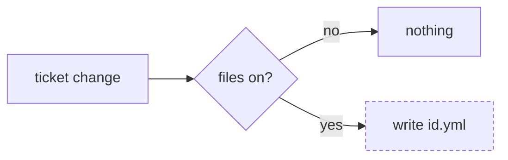

**Sequence** (calls over time)

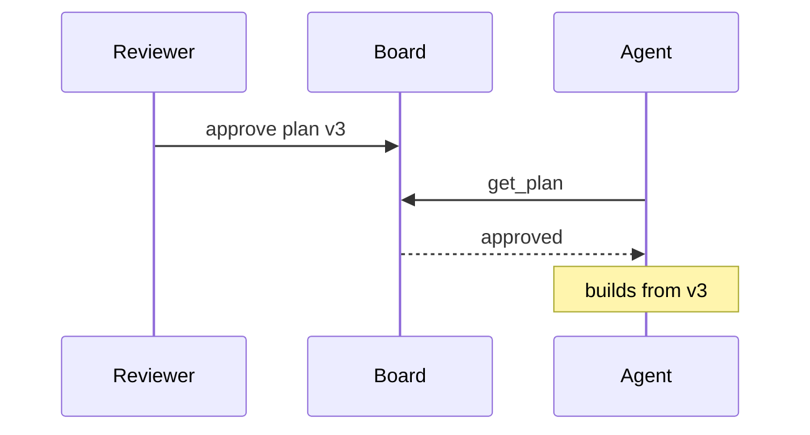

**State** (a lifecycle)

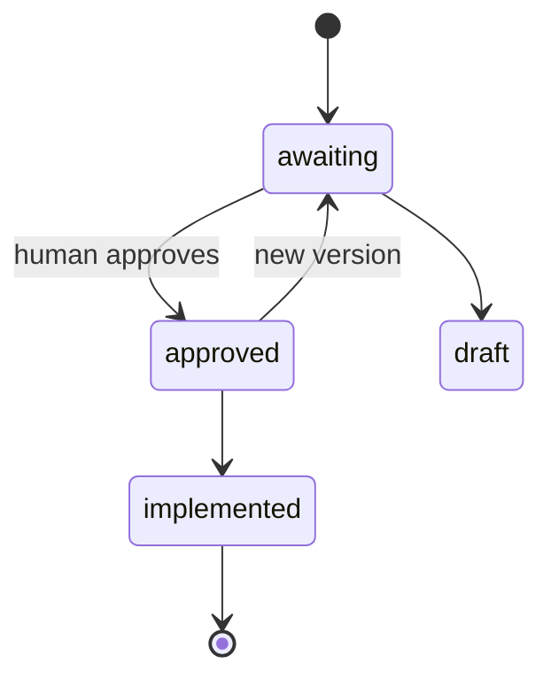

**ER** (tables and stored shapes)

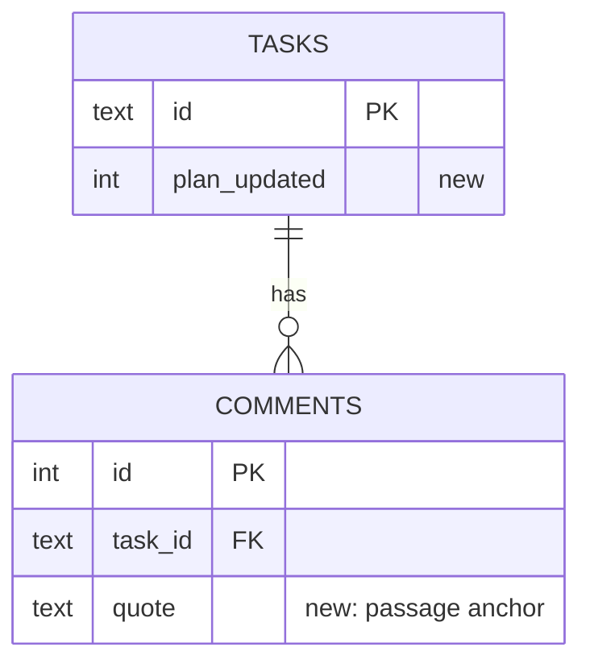

**Class** (types and interfaces)

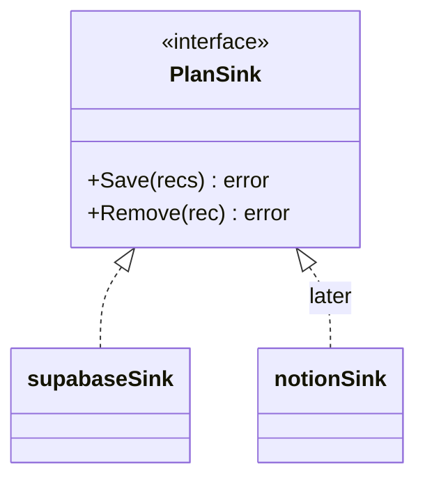

**Architecture** (components)

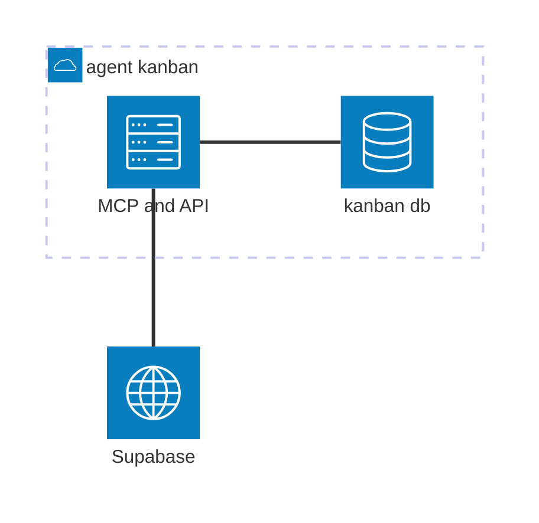

**C4 context** (systems and people)

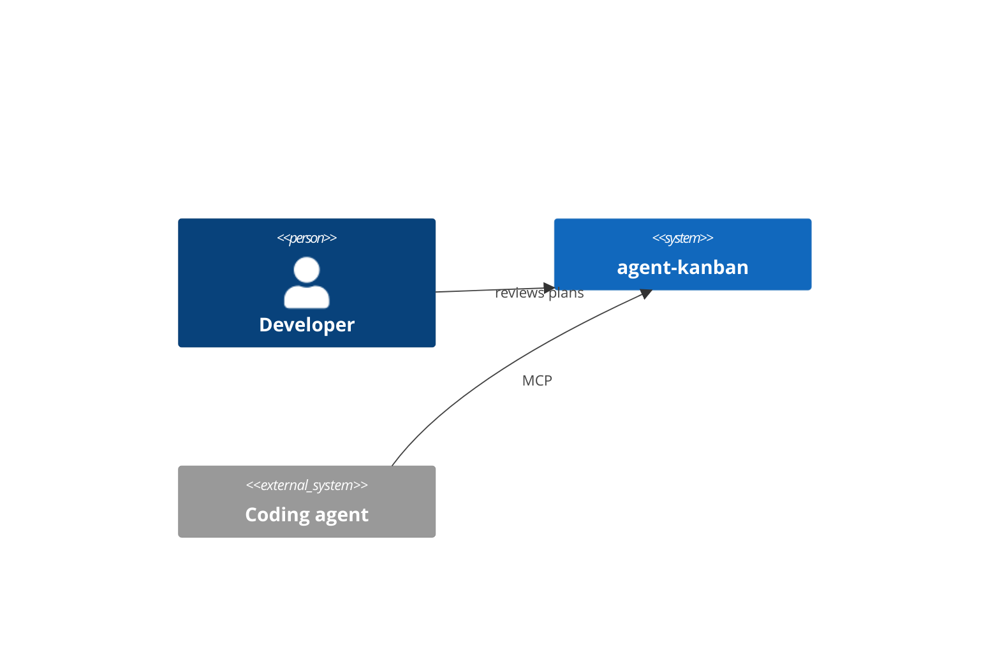

**Block** (layout of parts)

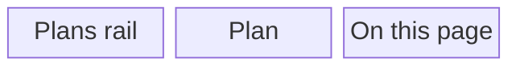

**Packet** (a wire format)

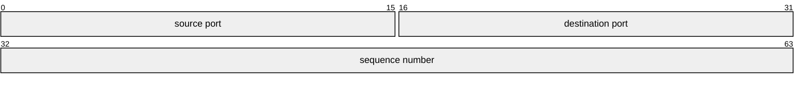

**Gantt** (phases)

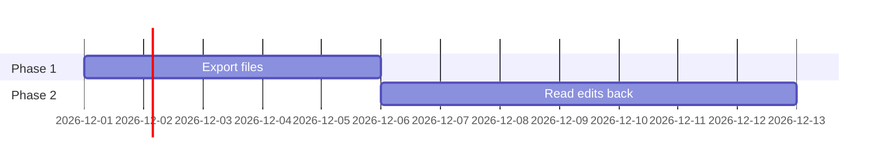

**Timeline** (order without dates)

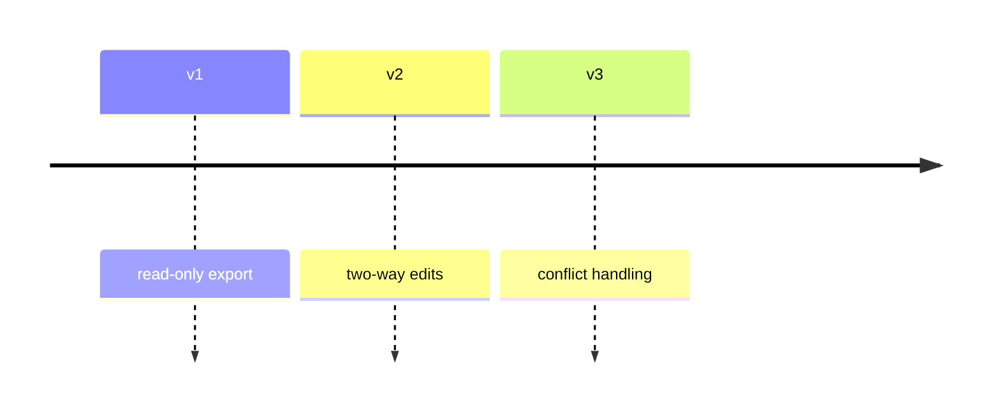

**Git graph** (branches and releases)

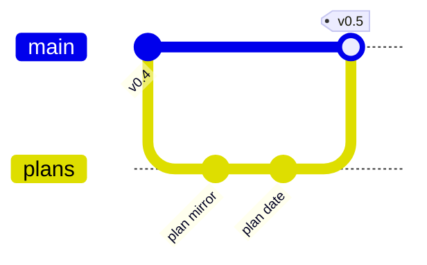

**Mindmap** (scope)

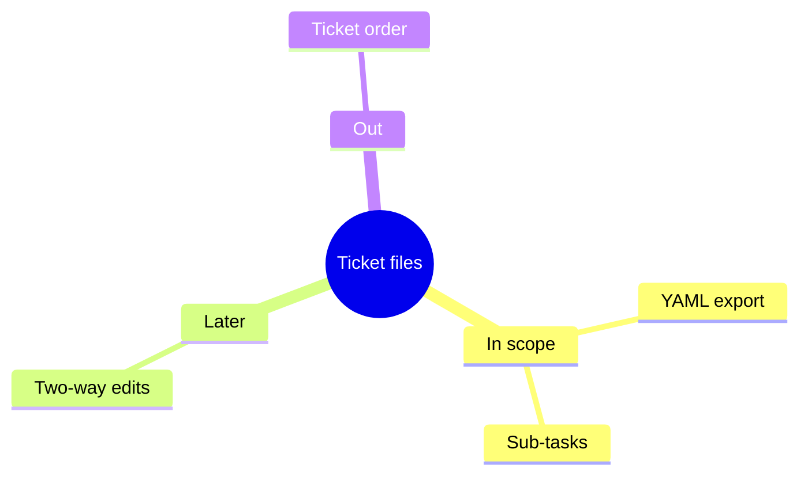

**Quadrant** (options on two axes)

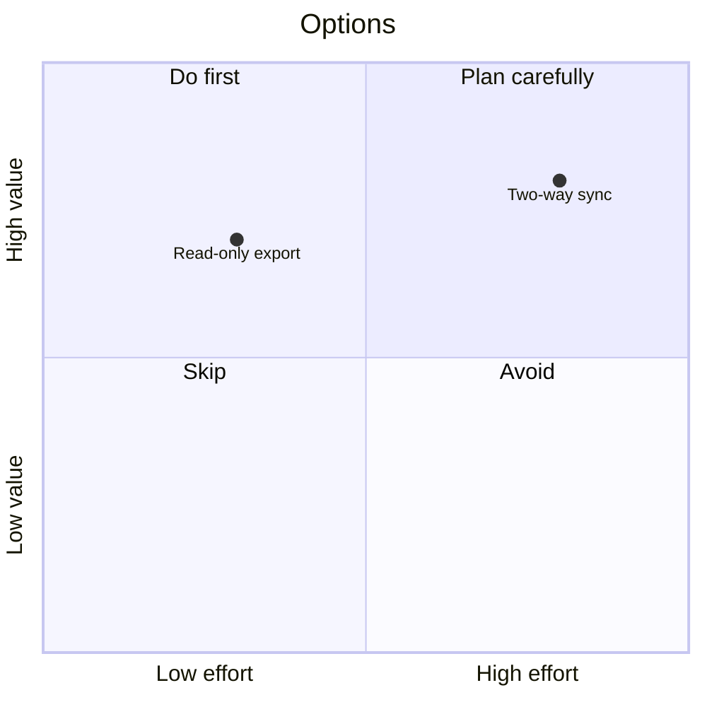

**Journey** (a user's steps)

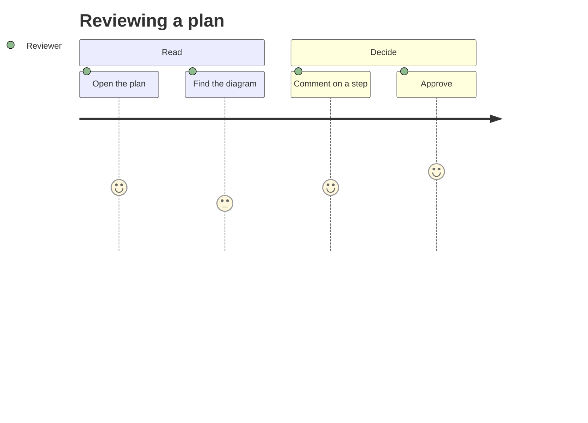

**Requirement** (traced to tests)

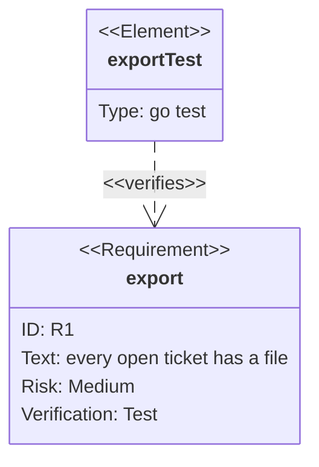

**Sankey** (where volume goes)

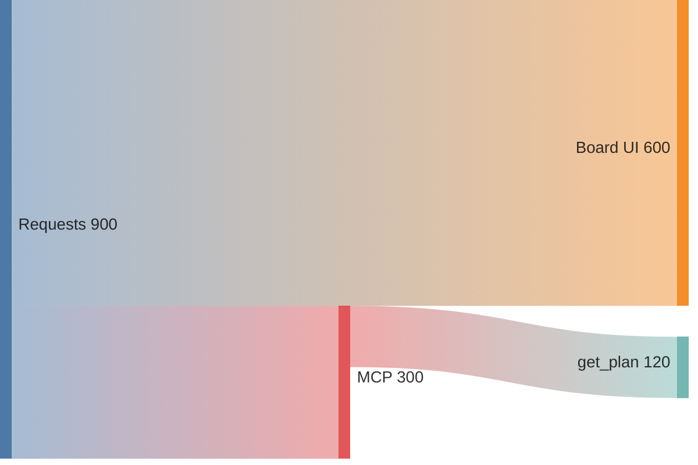

**XY chart** (numbers)

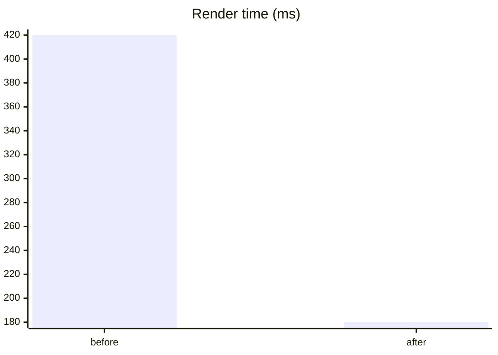
